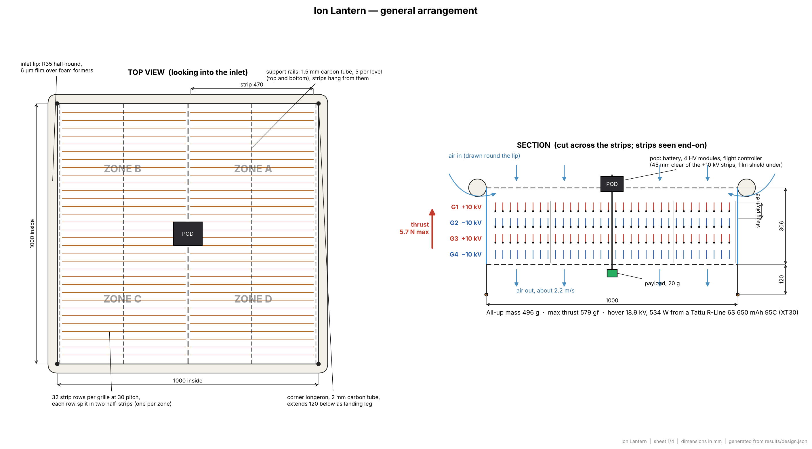
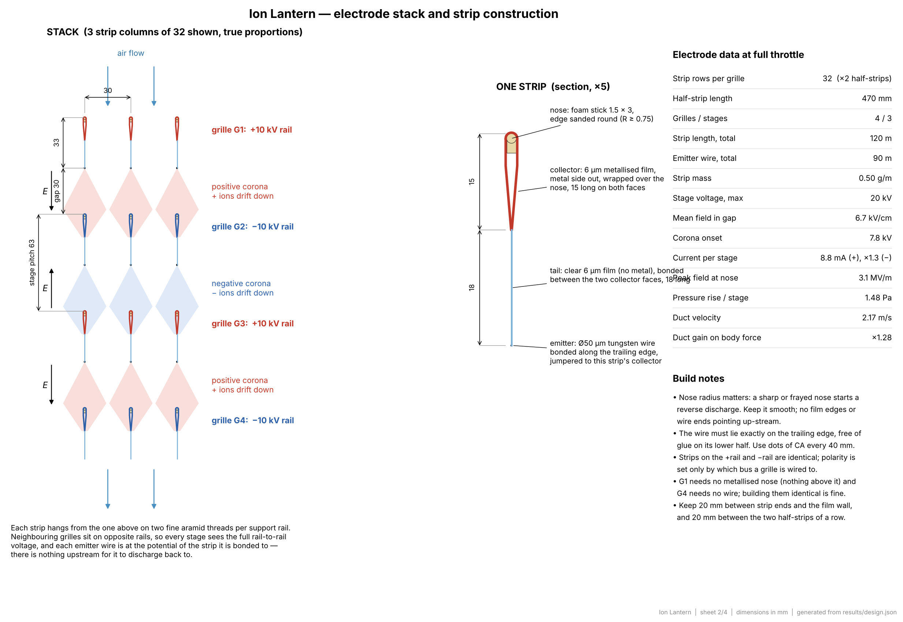
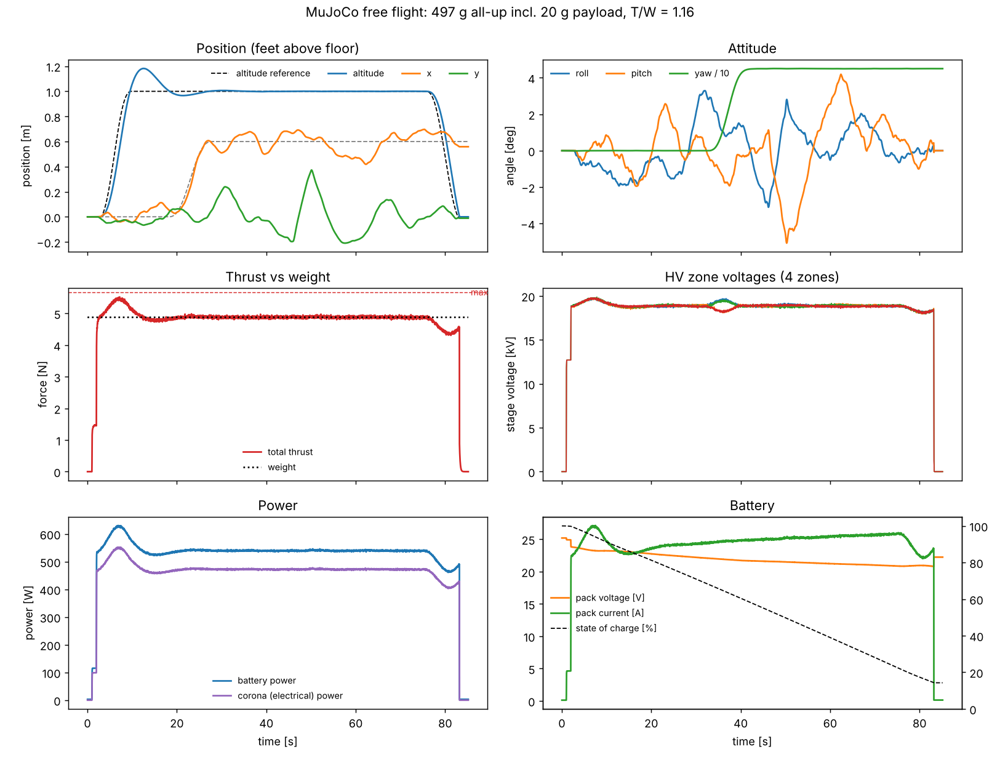
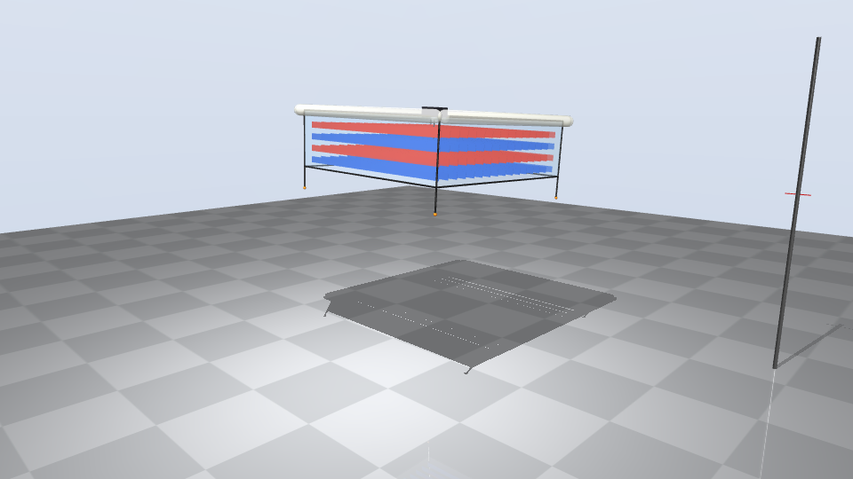
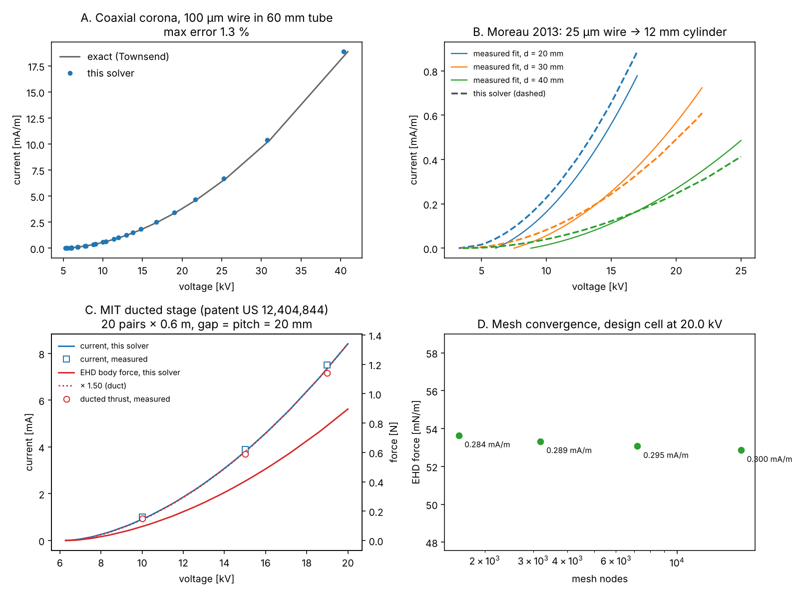
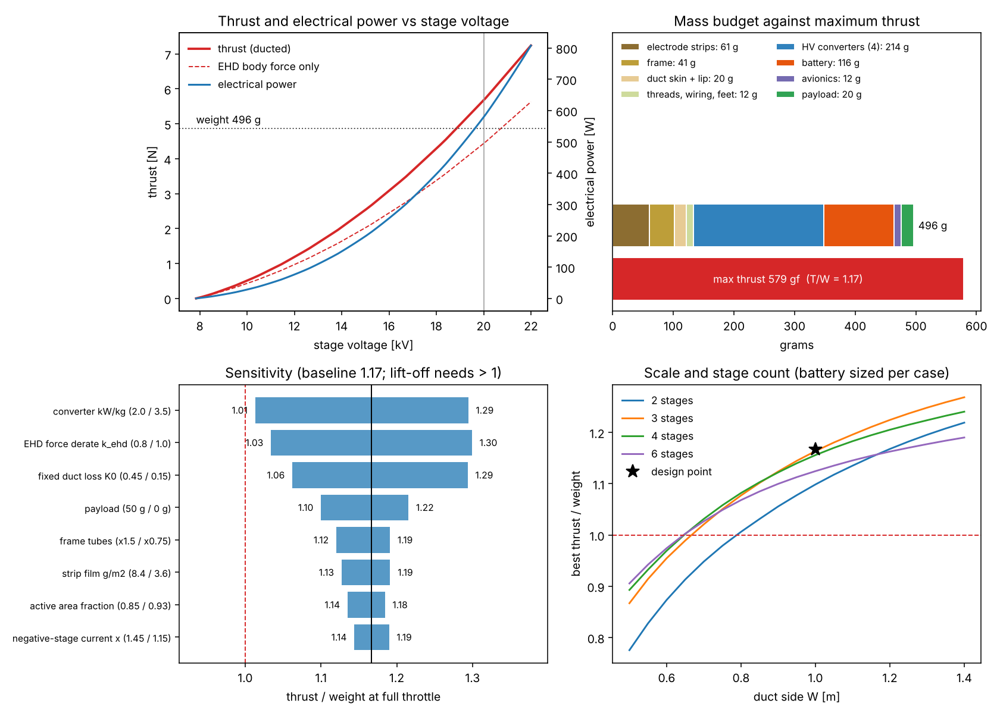
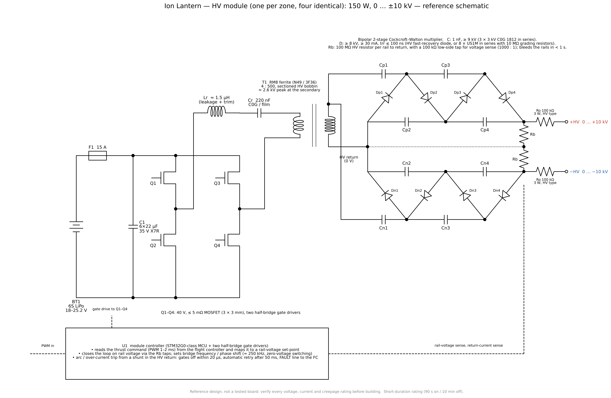
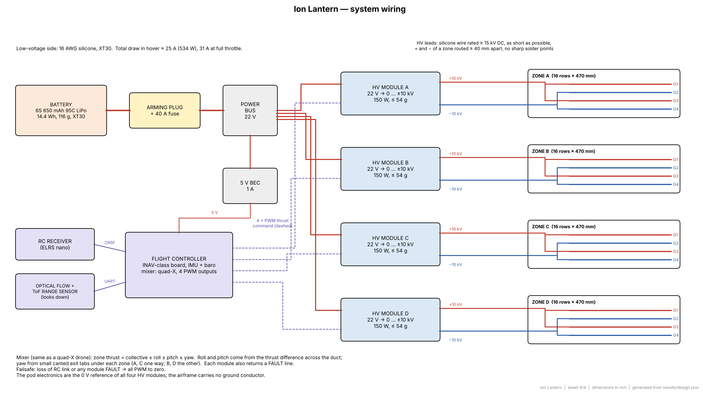

# Plasma — a battery-powered corona thruster that lifts itself

**Ion Lantern** is a paper design for a 1 m ducted, three-stage corona-discharge
("ionic wind") thruster that carries its own lithium-polymer battery, four high-voltage
converters, a flight controller and a 20 g payload. This repository holds the physics
model, the flight simulation and the build drawings.

**Status: designed and simulated, not built.** The model predicts a maximum
thrust-to-weight ratio of **1.17**. That is enough to hover in still air, and not much
more. With every uncertain input set to its pessimistic value the ratio is 0.84 and
the craft stays on the ground; with optimistic values it is 1.54. The build guide puts
a cheap bench measurement before any real construction for that reason.



## The design in numbers

| | |
|---|---|
| Size | 1.0 × 1.0 m square duct, 306 mm tall, 120 mm legs |
| All-up mass | 496 g, including 20 g payload |
| Thruster | 3 stages in series, 120 m of electrode strip, emitters Ø 50 µm tungsten, 30 mm gap |
| Voltage | 20 kV across each stage at full throttle (rails at +10 kV and −10 kV) |
| Maximum thrust | 5.67 N (579 gf) at 579 W electrical, 9.8 N/kW |
| Hover | 18.9 kV, 471 W into the corona, 539 W (24.7 A, 38C) from the battery |
| Battery | Tattu R-Line 6S 650 mAh 95C LiPo, 116 g, 14.4 Wh |
| HV converters | 4 × 54 g, 22 V → ±10 kV, 145 W each, short-duration rated |
| Endurance (simulated) | 79 s airborne, landing with 14 % charge left |
| Control | Four independently throttled zones mixed like a quadrotor |

## How it works

A thin wire at high voltage ionises the air next to it. The ions drift to a collector
and drag air with them; the reaction on the electrodes is thrust. Three things make
this version light enough to carry its own power supply.

1. **A duct.** Air drawn round the rounded inlet lip pulls the lip upwards. The
   electrical power is unchanged, so the same watts give more thrust. MIT measured
   about 1.5 × on a single stage; with three stages and their losses this design gets
   1.28 ×.
2. **Stages in series with alternating polarity.** Four grilles of strips sit on
   alternate rails (+10, −10, +10, −10 kV). Every gap sees the full 20 kV, positive
   corona in stages 1 and 3 and negative corona in stage 2, all pushing air the same
   way. The converter only has to make 20 kV, where converters are lightest.
3. **Integrated strips.** Each strip is a collector at the top and carries the emitter
   wire for the next stage along its insulating trailing edge. The wire is at the same
   potential as the conductor above it, so it cannot discharge backwards. In an early
   model without this, half the ions flowed upstream and cancelled most of the thrust.



## What was simulated, and with what

| Layer | Tool | File |
|---|---|---|
| Corona discharge: Poisson + ion drift with a Peek/Kaptzov emitter condition, on an unstructured 2-D mesh | Own finite-element / finite-volume solver on gmsh meshes | `sim/corona.py` |
| Validation of that solver | — | `sim/validate_corona.py` |
| Duct aerodynamics, component masses, sizing, sensitivity | 1-D momentum model calibrated to measurement | `sim/sizing.py` |
| Free flight: rigid body, ground contact, four thrust actuators | **MuJoCo** | `sim/flight.py` |
| Battery, converter and aerodynamic models, flight controller | Python, applied to the MuJoCo model each step | `sim/flight.py` |

### Flight result



The craft spools up, leaves the ground at 3.7 s, climbs to 1 m, translates 0.6 m, yaws
45°, rides out a 0.18 m/s gust at 46 s and lands itself when the battery reaches 22 %.
Altitude holds within 4 cm rms and horizontal position within 14 cm rms; the gust
pushes it about 0.4 m. Video: `results/flight.mp4`.



The same simulation with other loads:

| Case | Thrust / weight | Lifts off? |
|---|---:|---|
| No payload | 1.21 | yes |
| 20 g payload (design) | 1.16 | yes |
| 50 g payload | 1.10 | yes, little control margin |
| Thrusters deliver 10 % less | 1.05 | yes, barely |
| Thrusters deliver 20 % less | 0.93 | no |

### How far the plasma model can be trusted



- **Exact solution** (coaxial wire and tube): within 1.3 % over the whole range.
- **MIT ducted stage** (US patent 12,404,844, figures read off graphs): the predicted
  current is within 2–9 % of the measured 1.0 / 3.9 / 7.5 mA. Measured thrust is
  1.46–1.57 × the model's body force; that ratio is what the duct model is calibrated
  to, and the calibration used here gives 1.39–1.43 × for that rig, slightly below it.
- **Moreau 2013** (single wire to a cylinder in open air): current within ±16 % at the
  top of each measured curve, but the model lights up at about 3.3 kV where their
  fitted threshold is 6–9 kV, and it over-predicts thrust per ampere by 24–50 %. They
  infer an ion mobility near 2.9 × 10⁻⁴ m²/V·s; the model uses 2.0 × 10⁻⁴. I have not
  resolved this. The design leans on the MIT data because that rig is the closer match
  (ducted, wire to flat plate, 20 mm gap, the same 50 µm wire).
- **Mesh**: force changes by 1.4 % and current by 6 % between 1,600 and 17,000 nodes.

### Where the margin goes



The converters are 43 % of the mass and the battery 23 %; the whole airframe is 27 %.
Thrust per watt is fixed by ion mobility and field strength, so the craft lives or
dies on how many watts per gram the power system delivers.

Each of these, taken alone, moves thrust-to-weight this far from the baseline 1.17:

| Assumption | Baseline | Range tried | Thrust / weight |
|---|---|---|---|
| Converter specific power | 2.7 kW/kg | 2.0 – 3.5 | 1.01 – 1.29 |
| Derate on computed body force | 0.90 | 0.8 – 1.0 | 1.03 – 1.30 |
| Fixed duct loss coefficient | 0.30 | 0.45 – 0.15 | 1.06 – 1.29 |
| Payload | 20 g | 50 – 0 g | 1.10 – 1.22 |
| Frame tube mass | 41 g | × 1.5 – × 0.75 | 1.12 – 1.19 |

## What is assumed, not shown

- **Converter weight.** 2.7 kW/kg has been reported once, in an MIT thesis, for a
  1.5 kW, 20 kV unit run for 40 s. The widely cited flight-proven figure is
  1.2 kW/kg at 40 kV. A 145 W module at 2.7 kW/kg is an extrapolation; the parts list
  adds up to 43 g against the 54 g budget, but no such board has been built here.
- **The strip geometry.** A wire on the trailing edge of a film strip is my
  arrangement, not a published one. The solver handles it, with the tail treated as
  charged-up insulation; it has no experimental check, hence the 0.90 derate.
- **Negative-corona stages** are scaled from one MIT data point (30 % more current,
  10 % more thrust than positive at the same voltage).
- **Airframe mass.** 134 g for a 1 m box of 6 µm film and 1.5 mm carbon tube is
  indoor-free-flight-model territory and needs that level of building skill.
- **Not modelled:** ground effect, end effects at strip ends and walls, charging of
  the duct film, humidity, strip flutter, electrostatic pull between grilles and
  frame, radio noise from the corona reaching the flight controller.

## Hazards

±10 kV at tens of milliamps is lethal. A 470 W corona, partly negative polarity, makes
ozone fast enough to exceed workplace limits in a normal room within one flight. Arcs
can set the film alight. `docs/BUILD.md` starts with the safety rules; read them before
anything else.

## Building it

- `docs/BUILD.md` — construction sequence and six test gates with pass numbers. The
  first gate is one stage of one zone on a kitchen scale: if it does not give 0.43 N
  at 20 kV, stop.
- `hardware/BOM.md` — parts, specifications and the mass budget.
- `hardware/01…04` — general arrangement, electrode detail, HV module schematic,
  system wiring (SVG and PNG, generated by `hardware/make_drawings.py`).





## Reproducing the results

```
python -m venv .venv && . .venv/bin/activate
pip install -r requirements.txt        # gmsh also needs libGLU (apt: libglu1-mesa)
cd sim
python sizing.py              # results/design.json, results/sizing.png
python validate_corona.py     # results/corona_validation.{json,png}
python flight.py              # results/flight.{json,png,mp4}; needs EGL (apt: libegl1)
cd .. && python hardware/make_drawings.py
```

`sim/design.py` holds the frozen design inputs. `python sizing.py --search` re-runs the
design-space search.

## Sources

- Xu et al., "Flight of an aeroplane with solid-state propulsion", Nature 563 (2018):
  <https://www.doi.org/10.1038/S41586-018-0707-9>
- Gomez-Vega, Brown, Xu, Barrett, "Ducted electroaerodynamic thrusters",
  US patent 12,404,844; and MIT summary of the 10-stage result:
  <https://aeroastro.mit.edu/news-impact/order-of-magnitude-improvement-in-electroaerodynamic-thrust-density-with-multistaged-ducted-thrusters>
- Moreau, Benard, Lan-Sun-Luk, Chabriat, "Electrohydrodynamic force produced by a
  wire-to-cylinder dc corona discharge in air at atmospheric pressure",
  J. Phys. D 46 (2013): <https://hal.univ-reunion.fr/hal-01691632>
- He, Woolston, Perreault, lightweight 40 kV converter, 1.2 kW/kg:
  <https://dspace.mit.edu/handle/1721.1/123508>; journal version:
  <https://per.mit.edu/wp-content/uploads/2023/10/YHe_2021_Lightweight-High-Voltage-Power-Converters_final-submission.pdf>
- MIT thesis reporting 2.7 kW/kg at 20 kV for a 40 s run:
  <https://dspace.mit.edu/handle/1721.1/163001>
- Battery mass: <https://www.racedayquads.com/products/tattu-r-line-version-1-0-22-2v-6s-650mah-lipo-micro-battery-xt30>
