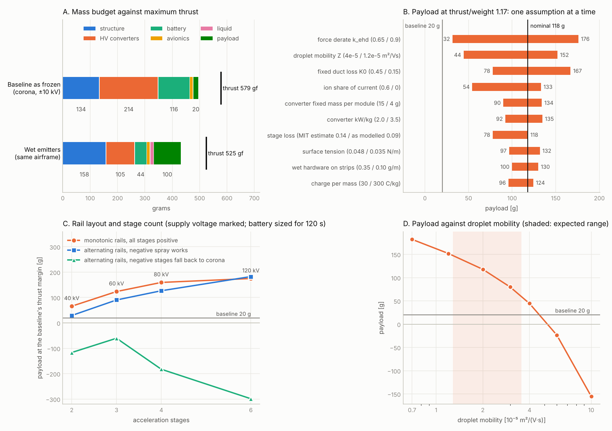
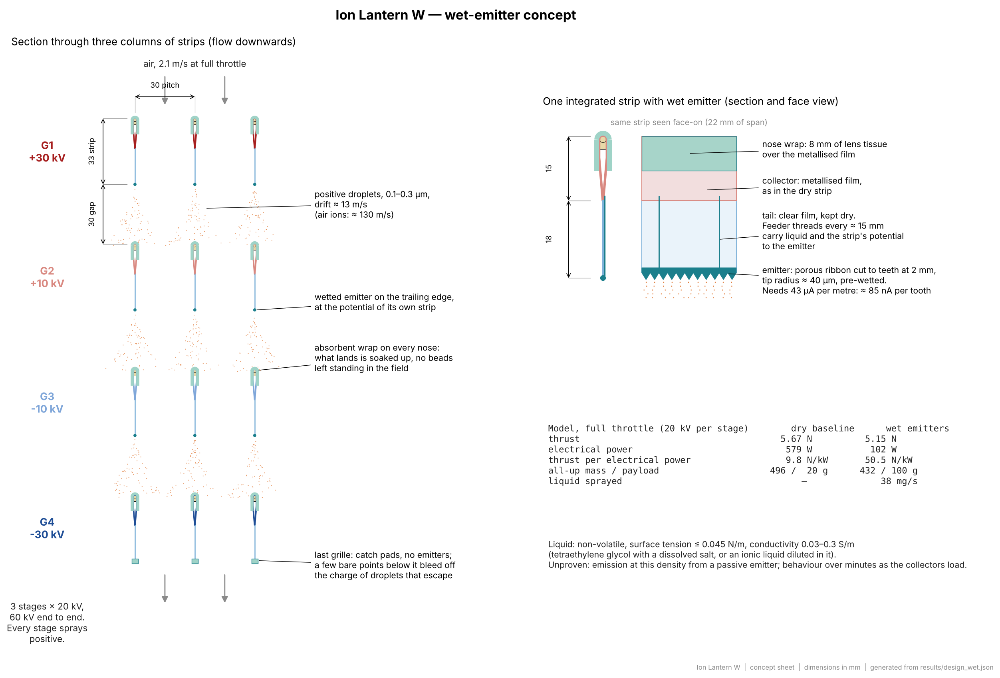
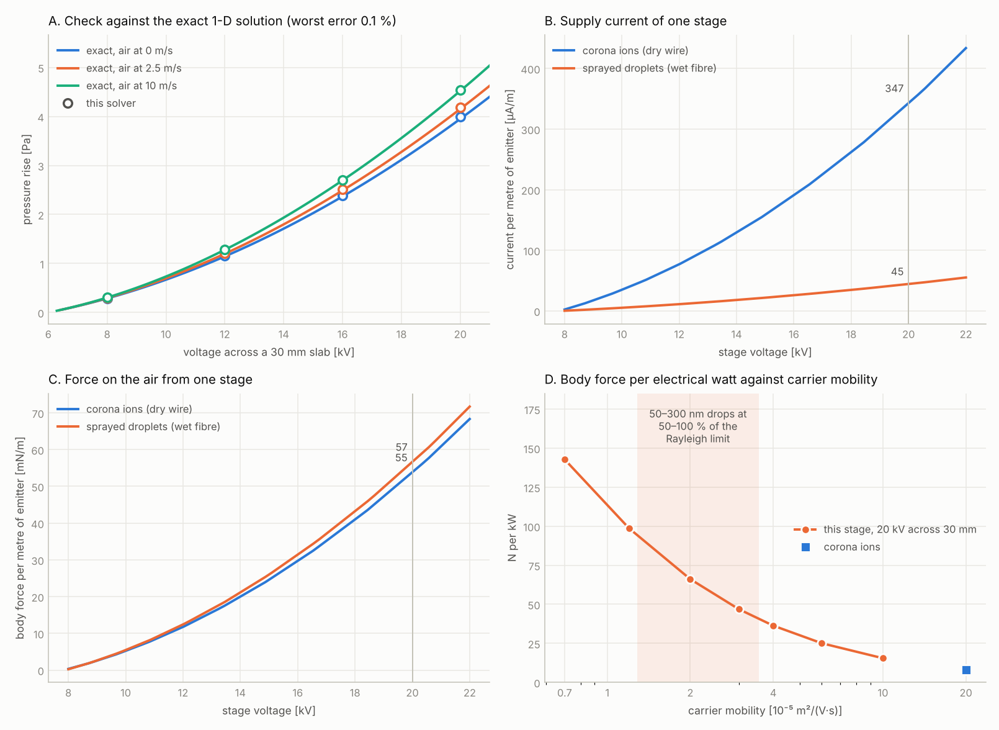
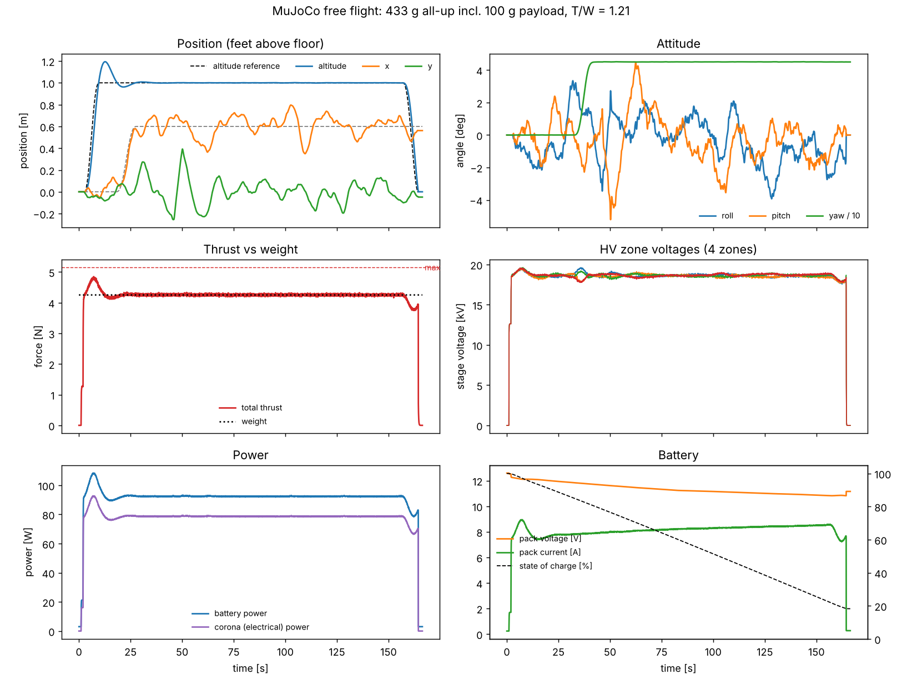

# Lifting more: sprayed droplets instead of corona ions

This is the result of a search for a way to make the Ion Lantern carry a larger payload.
It covers what was ruled out, the one route that survived, a model of it built on the
existing solver, and the bench test that would confirm or kill it.

**Status: modelled, not built, and not demonstrated by anyone.** The literature search
found no thrust measurement of a droplet-carrier thruster in air. Treat every number for
the wet-emitter craft as a prediction with a wide error band (see
[What could sink it](#what-could-sink-it)).

## Result in brief

The dry craft wastes about 99 % of its electrical power because its charge carriers, air
ions, race through the air at about 130 m/s while the air itself moves at 2 m/s. Thrust
per watt is one over the carrier's speed. Nothing published gets round this with ions.

The route that survives is to **change the carrier**: replace each corona wire with a
wetted emitter that electrosprays charged droplets of a non-volatile liquid. A droplet of
0.1–0.3 µm charged near its limit drifts about ten times slower than an ion, so the same
space charge, and therefore the same thrust, needs about an eighth of the current.

| | Dry baseline (as frozen) | Wet emitters, same airframe |
|---|---:|---:|
| Maximum thrust | 5.67 N | 5.15 N |
| Electrical power at full throttle | 579 W | 102 W |
| Thrust per electrical power | 9.8 N/kW | 50 N/kW |
| HV converters + battery | 330 g | 149 g |
| All-up mass | 496 g | 432 g |
| **Payload** | **20 g** | **100 g** |
| Thrust / weight | 1.17 | 1.21 |
| Hover power from the battery | 539 W | 92 W |
| Airborne time (simulated) | 79 s | 161 s |
| Supply | ±10 kV | 60 kV end to end (four rails) |

At the baseline's own thrust margin (T/W 1.17) the wet craft carries 118 g. With every
uncertain input pessimistic at once it does not fly at all (T/W 0.65 with 100 g); with
optimistic inputs T/W is 1.63. That band is wider than the dry craft's (0.84 – 1.54)
because more of the physics is untested.



## Why the dry thruster is stuck

An ion in a field E drifts at µE relative to the air and pushes on the air with force qE
the whole time. Its power draw is force times speed, so

    thrust / power = 1 / (µE + u)        µ = 2.0e-4 m²/(V·s) for air ions, u = air speed

At the design field (20 kV across 30 mm) µE is 133 m/s and u is 2 m/s. Thrust per area is
set separately, by how much charge the gap can hold (ε₀E² in order of magnitude), and does
not depend on µ at all. So for ions the two numbers that matter are tied to the same E:
lower it and thrust per watt improves but the craft needs more electrode area than its
structure can carry. The baseline already sits at that optimum.

Routes examined and dropped, with the best evidence found for each:

| Route | Evidence | Gain in lift per watt |
|---|---|---|
| Diffuser or venturi on the duct | An EHD stage is a pressure source, so in principle a larger exit multiplies thrust at the same power. With this stack's losses the best area ratio is 1.0–1.5 depending on where the fixed loss sits. MIT found converging nozzles lowered static thrust. | 0 to +10 % |
| Lower-loss stages and duct | Lossless duct would give 2.0 × body force against 1.28 × now. MIT's measured stage loss coefficient (0.14–0.15) is higher than the 0.09 modelled here, not lower. | no known way |
| Separate ion source (DBD or pulsed) plus DC drift | Could approach the space-charge limit at lower field, worth up to 1.7 ×. MIT measured +8 % once ioniser power is counted (about 35 keV per extracted ion). | +8 % |
| Emitter layout, auxiliary electrodes, AC on DC | +13 %, +26 %, +30 % (the last a preprint) | ≤ +30 % |
| Larger gaps | 2–3 × thrust per watt measured, at 70 kV and proportionally less thrust per area | structure-limited |
| Corona thrusters driving a rotor | Measured ion-wind propellers give 2.4–3.4 N/kW | worse |
| Mist or smoke charged by the corona | Own estimate: an ion crosses the gap in 0.2 ms, so capturing most ions needs about 10¹⁶ particles/m³, i.e. 0.2–0.4 g/s of aerosol | not practical |
| Lighter converter | 2.7 kW/kg is already a 40 s burst figure; the same unit gave 2.08 kW/kg over 110 s | none |
| Humidity | No significant change in thrust per watt between 20 and 80 % RH | none |
| Wings | MIT's aeroplane: 24 N of lift on 620 W | 4 ×, but not hover |
| Helium | About 1 g of lift per litre | works; not a thruster change |

## The idea

Lower the mobility instead of the field. For a droplet of diameter d carrying charge q,

    Z = q · Cc / (3π η d)                Cc = slip correction, η = air viscosity

A liquid surface can hold charge only up to the Rayleigh limit, q_R = π √(8 ε₀ γ d³).
Electrospray produces droplets at 50–100 % of it. Over 50–300 nm that gives
Z = 1.3–3.5 × 10⁻⁵ m²/(V·s), nearly independent of size: 6 to 15 times slower than an
ion. The model uses 2.0 × 10⁻⁵.

Three consequences:

1. **Same thrust.** The space charge a gap can hold is set by the voltage and geometry,
   not by what carries the charge. The solver gives 57 mN per metre of emitter for
   droplets against 54 for ions at 20 kV.
2. **An eighth of the current.** 44 µA per metre against 343.
3. **Small liquid use.** Sprayed droplets carry 30–300 C/kg, so the whole stack sprays
   about 38 mg/s. Most of it lands on the next row of strips.

Low-mobility carriers were suggested in patents from 1965 onwards (Gradecak; Marks;
Metcalfe & Cardwell), and Chapman, Kottke & Fedorov (2024) simulated the gas jet from a
single nano-electrospray needle; from their figures the thrust per watt is 3–6 times the
ion bound at the same field. No thrust-stand measurement was found. What is put together
here is a multistage ducted arrangement for it and a system model.

## What the craft would look like



The airframe is the baseline's: same duct, same four grilles of integrated strips, same
30 mm gap and 20 kV per stage. Four things change.

- **Emitter.** The tungsten wire on each trailing edge becomes a pre-wetted porous
  ribbon cut to teeth at about 2 mm pitch (tip radius about 40 µm), or a fuzzy wettable
  yarn. It needs 43 µA per metre, about 85 nA per tooth. Single wicks and cones at
  50–900 nA are well documented; this line density from a passive emitter is not.
- **Liquid.** Non-volatile, so droplets survive a 3 ms flight; surface tension at most
  about 0.045 N/m, so it sprays before the air breaks down; conductivity 0.03–0.3 S/m,
  so droplets come out at 0.1–0.3 µm. Candidates: tetraethylene glycol with a dissolved
  salt, or an ionic liquid such as EMI-Im diluted in it. Glycerol and water are out
  (surface tension too high); ethylene glycol and propylene carbonate evaporate in
  flight. The craft carries 13.5 g, twice what a flight sprays plus a fixed allowance.
- **Collector nose.** Each nose gets an 8 mm wrap of absorbent tissue. Liquid standing
  as beads in a 3 MV/m field would spray back towards the emitter; liquid held in pores
  cannot.
- **Rails.** Grille potentials fall by 20 kV per stage (+30, +10, −10, −30 kV), so every
  stage sprays positive droplets. The baseline's alternating ±10 kV rails would make
  every second stage spray negative, and negative sprays are reported to break into
  corona far below their spray onset. If that happened the gain would disappear
  (panel C above). A 60 kV supply would be too heavy at 580 W; at 102 W it costs 105 g
  for all four modules.

Two smaller items follow from the rails. About 6 % of the droplets are blown through
each collector row. With falling rails they are simply accelerated again, but the ones
leaving the last grille carry about 80 µA out of the craft, so a few bare points at the
exit have to bleed off the opposite charge. The last grille has catch pads and no
emitters.

Expected side effect: the ion current is roughly a twentieth of the baseline's, so
ozone production should fall by a similar factor. This is not modelled.

## Model and results

| Layer | What was added | File |
|---|---|---|
| Stage physics | Carriers of any mobility, carried along by the duct air as well as drifting; potential flow through the strip row; an outflow boundary; spray-onset emitter law | `sim/carrier.py` |
| System | Wet-emitter mass and power model, rail layouts, sensitivity, design report, figures | `sim/wet.py` |
| Flight | Same MuJoCo model as the baseline, fed the new thrust map, masses and battery | `sim/flight.py` via `sim/wet.py` |
| Concept sheet | `hardware/05_wet_emitter_concept` | `hardware/make_wet_drawing.py` |



- **Check (panel A).** For a plane gap with drift and convection there is an exact
  solution. The solver matches its pressure rise within 0.1 % and its voltage within
  0.6 %. With convection switched off and periodic boundaries it reproduces
  `corona.py` to the last digit.
- **Stage (panels B, C).** At 20 kV the wet stage draws 44 µA/m against 343 for ions
  and delivers 57 mN/m against 54. Body force per watt is 66 N/kW against 7.9.
- **Mobility (panel D).** The gain falls off as 1/(ZE + u): 12 × over ions at
  Z = 1.2e-5, 8 × at the nominal 2.0e-5, 4.6 × at 4e-5.

System assumptions that have no counterpart in the dry model, and the range tried:

| Assumption | Nominal | Range | Payload at T/W 1.17 |
|---|---|---|---|
| Droplet mobility | 2.0e-5 m²/(V·s) | 4e-5 – 1.2e-5 | 44 – 152 g |
| Derate on computed force (discrete sites, uneven wetting) | 0.80 | 0.65 – 0.90 | 32 – 176 g |
| Share of current carried by ions from stray corona | 25 % | 60 % – 0 | 54 – 133 g |
| Fixed converter mass per module | 8 g | 15 – 4 g | 90 – 134 g |
| Surface tension | 0.040 N/m | 0.048 – 0.035 | 97 – 132 g |
| Charge per mass of the spray | 100 C/kg | 30 – 300 | 96 – 124 g |
| Wet hardware on the strips | 0.20 g/m | 0.35 – 0.10 | 100 – 130 g |

Each one alone leaves the payload above the baseline's 20 g. Several bad ones together
do not: the conservative case combines mobility 3e-5, 50 % ion current, derate 0.65,
converter 2.0 kW/kg, duct loss 0.4, 30 C/kg and 0.3 g/m, and gives T/W 0.65.

**Flight.** With 100 g of payload the simulated craft lifts off at 3.8 s, flies the
baseline's mission (climb 1 m, translate 0.6 m, yaw 45°, one gust) and lands itself at
18 % charge after 161 s in the air. Altitude holds within 3 cm rms and position within
14 cm rms. It also lifts off with 150 g (T/W 1.09) and with thrust 10 % low; with thrust
20 % low it stays on the ground. The spray's response to a voltage step is assumed to be
50 ms; nothing is known about it.



More stages raise the payload further (160 g at four, panel C) but need 80 kV.

## What could sink it

In rough order of how likely each is to be the problem:

1. **The emitter does not deliver the current density.** The closest published
   hardware, passive porous-wick arrays, ran at 180–400 nA per wick at centimetre pitch:
   about a third of the area density needed here. If the liquid supply to the teeth
   cannot keep up, the surface field rises until the dry parts go into corona, and ions
   then carry the current at ten times the cost.
2. **Corona alongside the spray.** The spray-onset field is 83 % of the corona-onset
   field for this liquid and tip radius. That is a narrow window. The model assumes 25 %
   of the current is ions.
3. **Back-spray from wet collectors.** The field at the collector nose is 3.2 MV/m.
   The absorbent wrap is the countermeasure; whether it holds over minutes of
   deposition has not been tested by anyone.
4. **Leakage along wet surfaces.** A conductive liquid creeping over threads and film
   between rails 20 kV apart would short the stack. No quantitative source was found.
5. **Droplet mobility at the fast end.** Above about 4.7e-5 the payload gain is gone.
   Droplets that shed ions (below about 40 nm) or shatter would be faster.
6. **60 kV on a film airframe.** Grilles sit at up to ±30 kV to the surroundings,
   against ±10 kV for the baseline. Clearances, corona from the frame and safety
   distances all grow.
7. **The model's own limits.** Two-dimensional; uniform emission along the emitter;
   droplets all the same; no interaction between a stage's leaked droplets and the next
   stage's spray beyond a fixed penalty or none.

## One bench test decides

Do this before building any HV module: if it passes, the modules are 25 W, 60 kV units
and not the 145 W, 20 kV units of `docs/BUILD.md`.

Use the one-stage rig of BUILD.md step 2 (one zone, 7.5 m of strip, in its duct, on a
scale, bench HV supply through a micro-ammeter). Measure it dry with the tungsten wire
first, then replace the wires with wetted emitters. The model predicts:

| Stage voltage | Dry: current | Dry: thrust | Wet: current | Wet: thrust |
|---:|---:|---:|---:|---:|
| 12 kV | 0.56 mA | 0.11 N | 0.09 mA | 0.10 N |
| 16 kV | 1.40 mA | 0.28 N | 0.21 mA | 0.26 N |
| 20 kV | 2.53 mA | 0.52 N | 0.39 mA | 0.47 N |

That is about 200 N per ampere dry and 1200 N per ampere wet.

| Gate | Measure | Pass |
|---|---|---|
| W-1 | Thrust per ampere at 20 kV, wet against dry in the same rig | ≥ 4 × the dry value. Below 3 × the wet craft carries no more than the dry one: stop. |
| W-2 | Thrust at 20 kV | ≥ 0.40 N |
| W-3 | Both of the above over 3 minutes continuous, and again on the tenth run without drying the collectors | Within 10 % of the first reading |
| W-4 | Dark room | No glow along the emitters. Glow marks corona, i.e. dry or over-stressed spots. |
| W-5 | Reverse the polarity | For information. If thrust per ampere stays ≥ 4 ×, the lighter ±10 kV alternating rails become an option. |

A quicker first look needs only one 0.3 m emitter above two collector strips on a
milligram balance: 17 mN at 20 kV, at one sixth of the dry wire's current.

Extra hazards on top of BUILD.md's: the rig sprays about 3 mg/s of fine mist, some of
which escapes, so ventilate and choose a low-toxicity liquid (the glycol route; treat
ionic liquids as an unknown inhalation hazard). Wet film between HV rails can track and
arc.

## A correction to the dry baseline

Extending the solver exposed two faults in how the frozen baseline counts current. Its
periodic cell wraps ions that pass a collector row into the next stage, where they are
accelerated a second time and shield the emitter; that is right for falling rails but
not for the baseline's alternating ones. And it counts only the current landing on the
first half of each collector chord.

With the outflow boundary the dry stack gives 5.77 N for 676 W, where the frozen figures
are 5.67 N for 579 W. Thrust is unchanged; current is 17 % higher. That puts the dry
craft at **T/W 1.10 with its 20 g payload, not 1.17**, and the rig current in BUILD.md
gate G-A at 2.53 mA where the table says 2.20 mA.

The frozen baseline files (`results/design.json`, README tables, BOM, BUILD gate
numbers, drawings, flight results) have **not** been changed. The comparison table at
the top uses the frozen figures, which flatters the dry craft.

## Reproducing

```
cd sim
python wet.py                       # results/design_wet.json, wet_stage.png, wet_sizing.png, flight_wet.{json,png}
cd .. && python hardware/make_wet_drawing.py
```

The first run solves about 30 stage curves and takes roughly 20 minutes; they are cached
in `results/stage_curves/`.

## Sources

Gathered by literature search for this study. Publisher pages were often blocked, so
several were read as author copies, theses or patents, and a few only as abstracts
(marked).

Electroaerodynamic thrusters:
- Gomez-Vega & Barrett, "Multistaged ducted electroaerodynamic thrusters", AIAA J. 62
  (2024), <https://arc.aiaa.org/doi/10.2514/1.J063431>; read via Gomez-Vega's thesis,
  <https://dspace.mit.edu/handle/1721.1/151296>
- Gomez-Vega, Xu, Abel, Barrett, decoupled DBD thruster, Appl. Phys. Lett. 118 (2021),
  <https://dspace.mit.edu/handle/1721.1/145283>
- Barrett, Brown, Gomez-Vega, NIAC Phase I report (2023),
  <https://ntrs.nasa.gov/citations/20250001538>
- Brown, PhD thesis, MIT 2023 (aeroplane data), <https://dspace.mit.edu/handle/1721.1/151685>
- Shevgaonkar, SM thesis, MIT 2025 (2.71 / 2.08 / 1.82 kW/kg at 40 / 110 / 180 s),
  <https://dspace.mit.edu/handle/1721.1/163001>
- Chirita & Ieta, ion-wind propeller, Sci. Rep. 12 (2022),
  <https://www.nature.com/articles/s41598-022-23377-5>
- Wilson, Perkins, Thompson, NASA/TM-2009-215822, <https://ntrs.nasa.gov/citations/20100000021>
- Usuelli et al., humidity, Mater. Res. Proc. 69 (2026), doi:10.21741/9781644904251-112

Droplets as carriers:
- Chapman, Kottke, Fedorov, "Thermodynamic analysis of nano-electrospray induced gas
  jets", Int. J. Multiphase Flow 174 (2024), <https://www.osti.gov/pages/biblio/2293607>
- Gradecak, US 3,177,654 (1965); Marks, US 4,523,112 (1985); Metcalfe & Cardwell,
  US 7,584,601 (2009)

Electrospray emitters and liquids:
- Fernández de la Mora & Loscertales, J. Fluid Mech. 260 (1994),
  <https://doi.org/10.1017/S0022112094003472> (abstract)
- Tepper & Kessick, porous-wick arrays, Appl. Phys. Lett. 94 (2009) (abstract); numbers
  from US 2010/0243885 A1
- Deng & Gomez, space charge in multiplexed electrosprays, J. Aerosol Sci. 38 (2007),
  <https://www.eng.yale.edu/gomez-lab/research/pdf/Spacecharge.pdf>
- Borra et al., US 6,679,441 (surface-tension limit for spraying in air)
- Li et al., negative-mode discharge, Anal. Chem. 92 (2020),
  <https://pmc.ncbi.nlm.nih.gov/articles/PMC7318871>
- Krieger et al., vapour pressures of glycols, Atmos. Meas. Tech. 11 (2018),
  <https://amt.copernicus.org/articles/11/49/2018/amt-11-49-2018.pdf>
